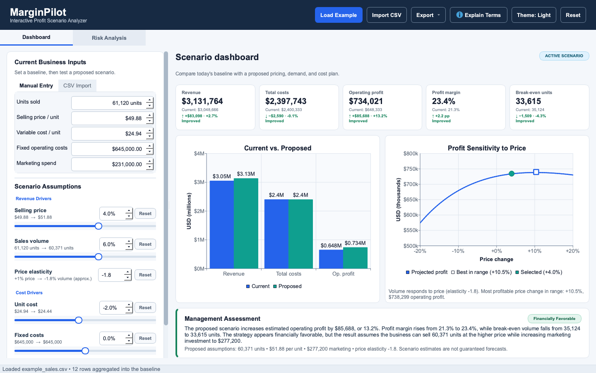
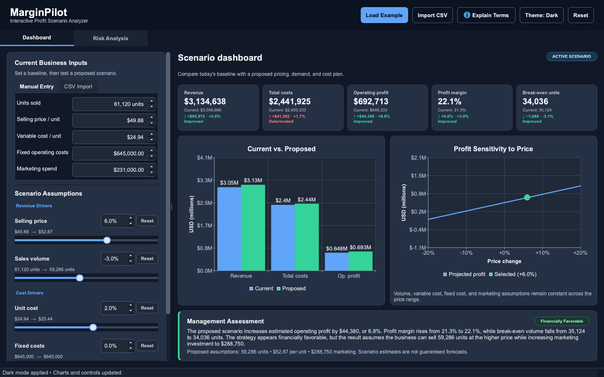
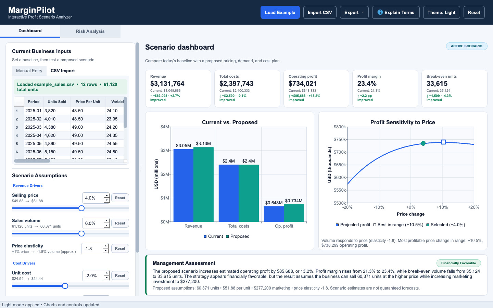
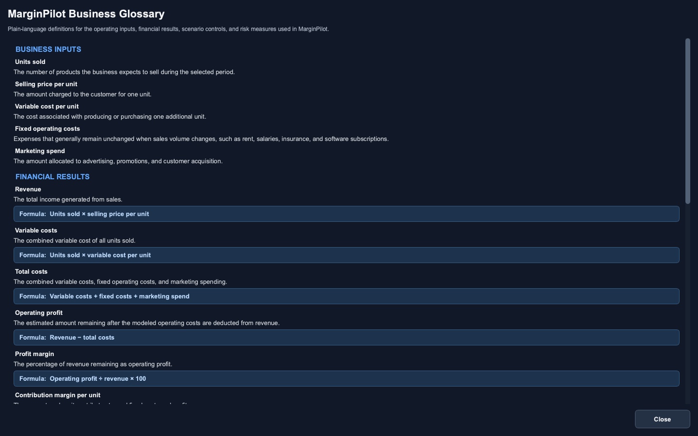
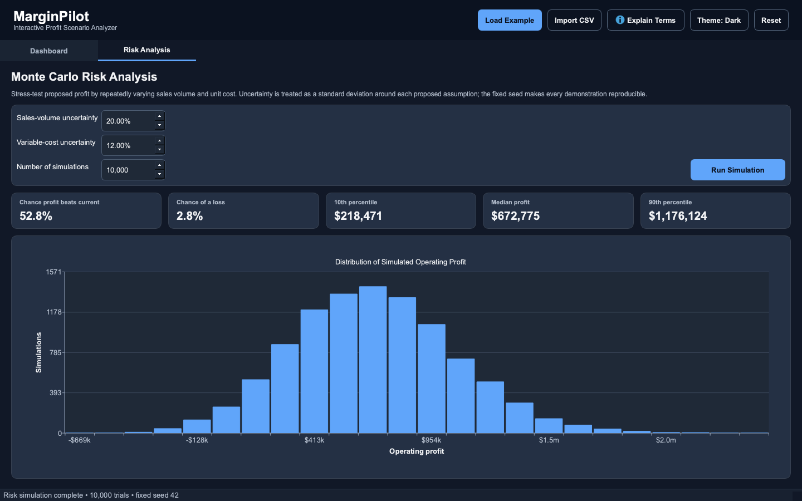

# MarginPilot — Interactive Profit Scenario Analyzer

MarginPilot is a polished, local-first Python desktop application for comparing a current operating baseline with proposed pricing, sales-volume, and cost scenarios. It turns raw operating assumptions into financial KPIs, visual tradeoffs, a management assessment, and an understandable risk analysis.

| Light dashboard | Dark dashboard |
| --- | --- |
|  |  |

> **Portfolio statement:** MarginPilot demonstrates how business strategy, financial analysis, and software development can be combined to turn raw operating data into actionable management decisions.

## Business problem

Pricing and cost decisions interact. A higher price can improve unit economics but weaken demand; additional marketing can support volume while raising the break-even point. Spreadsheet models can answer these questions, but they are often difficult to demonstrate, easy to alter accidentally, and weak at communicating the decision.

MarginPilot provides a repeatable decision workspace where a manager can establish a baseline, adjust the major commercial levers, see results immediately, and communicate both the expected outcome and its uncertainty.

## Main features

- Manual baseline entry with validated units, price, variable cost, fixed cost, and marketing inputs
- Validated CSV import with a preserved read-only data preview and clear row-specific errors
- Five synchronized slider and numeric scenario controls with one-click resets
- Current-to-proposed values shown directly beside every scenario control
- Current vs. proposed KPI cards showing absolute and percentage changes with accessible direction labels
- Live grouped bar chart for revenue, total costs, and operating profit, including negative profit
- Price-sensitivity curve from -20% to +20%, with the selected scenario highlighted
- Deterministic Management Assessment with a financial status and explicit assumptions
- Scrollable **Explain Terms** glossary with plain-language definitions and formulas
- Complete Light and Dark modes with immediate chart updates and persistent selection
- Reproducible Monte Carlo simulation with risk probabilities, percentiles, and a profit histogram
- Fully local operation: **no uploads, external APIs, telemetry, AI features, or database**

## Installation

Python 3.11 or newer is required. From the project directory:

```bash
python3 -m venv .venv
source .venv/bin/activate
python -m pip install --upgrade pip
python -m pip install -e ".[dev]"
```

On Windows PowerShell, activate the environment with:

```powershell
.venv\Scripts\Activate.ps1
```

## Run the application

```bash
python main.py
```

Select **Load Example** in the header to open the included 12-month dataset for fictional consumer-products company Northstar Home Goods. Adjust any scenario slider and the dashboard recalculates immediately. Open **Risk Analysis** and select **Run Simulation** to stress-test the proposal.

Select **Theme: Light** or **Theme: Dark** in the header to switch appearance immediately. MarginPilot remembers the selection between sessions. On the first launch, it uses the operating-system color preference when Qt can detect it and otherwise starts in Light mode.

The application does not need an internet connection. Imported files and calculated results remain on the computer running MarginPilot.

## CSV import

CSV files must contain these columns (additional columns are ignored):

| period | units_sold | price_per_unit | variable_cost_per_unit | fixed_costs | marketing_spend |
| --- | ---: | ---: | ---: | ---: | ---: |
| 2025-01 | 3820 | 48.50 | 24.10 | 52500 | 13200 |
| 2025-02 | 4010 | 48.50 | 23.95 | 52500 | 12600 |

Numeric fields accept integers or decimals and must be zero or greater. Missing columns, blank cells, non-numeric values, infinity, and negative values produce a specific error rather than terminating the application.

Imported rows are aggregated as follows:

- Total units = sum of `units_sold`
- Revenue = sum of `units_sold × price_per_unit`
- Variable costs = sum of `units_sold × variable_cost_per_unit`
- Fixed costs and marketing spend = their respective column sums
- Baseline average selling price = total revenue ÷ total units
- Baseline average variable cost = total variable costs ÷ total units

The weighted averages preserve total revenue and variable cost when monthly unit volumes differ. If total units are zero, both averages safely resolve to zero.



## Financial logic

For both current and proposed scenarios, MarginPilot calculates:

```text
Revenue                     = units sold × selling price
Variable costs              = units sold × variable cost per unit
Total costs                 = variable costs + fixed costs + marketing spend
Operating profit            = revenue − total costs
Profit margin               = operating profit ÷ revenue × 100
Contribution margin / unit  = selling price − variable cost per unit
Break-even units            = (fixed costs + marketing spend) ÷ contribution margin / unit
```

Profit margin is shown as `N/A` when revenue is zero. Break-even units are shown as `N/A` when contribution margin is zero or negative.

## Business glossary

Select **Explain Terms** in the header for a read-only reference covering every business input, financial result, scenario control, formula, and Monte Carlo measure. The scrollable glossary follows the active application theme and remains usable on smaller screens.



### Scenario and sensitivity assumptions

Each scenario percentage is applied independently to its baseline input. For example, a +5% volume change multiplies baseline units by 1.05, and a -3% variable-cost change multiplies baseline unit cost by 0.97. The model does not infer price elasticity or automatically connect marketing to demand.

The **Profit Sensitivity** chart varies price from -20% to +20%. At every point it holds the selected sales-volume, variable-cost, fixed-cost, and marketing changes constant. This isolates price sensitivity; it is not a demand-response forecast.

## Monte Carlo risk analysis in plain language

A single forecast can imply more certainty than a real operating plan deserves. Monte Carlo simulation asks, "What happens if volume and unit cost vary around our proposal?" MarginPilot draws many possible volume and unit-cost outcomes, calculates profit for each, and summarizes the distribution.

The two uncertainty inputs are standard deviations around the proposed values. For an approximately normal distribution, about two-thirds of simulated values fall within one selected uncertainty percentage of the proposal. Negative simulated volume and cost are clipped to zero. Price, fixed cost, and marketing spend remain at their proposed values.

The fixed default random seed (`42`) makes results reproducible for demonstrations and tests. The risk view reports:

- Probability that proposed simulated profit exceeds current deterministic profit
- Probability that the business makes an operating loss
- 10th-percentile profit (downside), median profit, and 90th-percentile profit (upside)

This is an understandable planning aid, not a statistically calibrated forecast. The output is only as credible as the uncertainty assumptions supplied.



> **Financial-estimate disclaimer:** MarginPilot provides scenario-based estimates using values supplied by the user. Its results are decision-support information, not guaranteed financial forecasts.

## Architecture

```text
main.py                         Application entry point
src/marginpilot/
  models/financial_model.py     Pure financial calculations and scenario changes
  models/recommendation_model.py Deterministic management assessment
  models/risk_model.py          NumPy Monte Carlo simulation
  services/csv_service.py       pandas validation and weighted aggregation
  widgets/                      Inputs, KPIs, charts, glossary, assessment, and risk UI
  main_window.py                Application orchestration
  theme_manager.py              Central theme selection and QSettings persistence
  resources/*_theme.qss         Complete Light and Dark application themes
sample_data/                    Recruiter-ready example dataset
scripts/capture_screenshots.py  Deterministic real-application capture
tests/                          Unit tests for finance, CSV, and risk behavior
```

Financial calculations have no Qt dependency, CSV processing is isolated from presentation, and the window coordinates model outputs and reusable widgets. This keeps the most important business rules straightforward to review and test.

## Testing

Run the complete suite:

```bash
pytest
```

The tests cover profitable and loss-making operations, zero units and revenue, non-positive contribution margins, break-even math, scenario percentages, management-assessment language and formatting, theme persistence, CSV aggregation and validation, and fixed-seed simulation reproducibility.

To regenerate real screenshots at 1440×900 using the included example:

```bash
QT_QPA_PLATFORM=offscreen python scripts/capture_screenshots.py
```

The script opens the actual PySide6 window, loads the CSV, applies a scenario, switches both themes, opens the real glossary, runs the simulation, captures each view with `QWidget.grab()`, and verifies image readability, file size, and dimensions. The repository contains no mockups or placeholder screenshots.

## Known limitations

- The model is a single-product-equivalent operating model; imported price and unit cost are weighted averages.
- Scenario changes are independent and do not estimate price elasticity, marketing response, seasonality, or taxes.
- Monte Carlo inputs are user-selected assumptions, use normal distributions, and model only volume and variable-unit-cost uncertainty.
- Currency display uses dollars and is not currently configurable.
- Imported data is held only for the active session and is not saved to a database.

## Possible future improvements

- Configurable currency and fiscal-period settings
- Multi-product contribution-margin analysis
- Optional price-elasticity and marketing-response models
- Scenario save/export and printable executive summaries
- Correlated risk factors and alternative probability distributions
- Accessibility review with additional keyboard-navigation testing

## Why I built this

As an MBA student, I wanted a portfolio project that went beyond calculating a correct answer. Managers need to understand which assumptions drive a result, how much a proposal changes profit, and what downside remains. MarginPilot combines the financial logic of contribution analysis with an interface designed for a concise decision conversation. It also demonstrates that business analysis can be packaged as maintainable, tested software rather than left as a one-off spreadsheet.

## AI usage acknowledgment

Generative AI tools assisted during development with brainstorming, code drafting and refinement, debugging, test development, and documentation. I reviewed, tested, and took responsibility for the final implementation and project decisions. MarginPilot itself does not use AI at runtime, send data to an AI service, or require an internet connection.

## License

MarginPilot is available under the [MIT License](LICENSE).
